# ha-system-monitor-card

[](https://github.com/hacs/integration)
[](https://github.com/juju35/ha-system-monitor-card/actions/workflows/hacs.yml)
[](https://github.com/juju35/ha-system-monitor-card/actions/workflows/validate.yml)
[](https://github.com/juju35/ha-system-monitor-card/releases/latest)
[](LICENSE)

<p align="center"></p>

Lovelace cards for Home Assistant to monitor the machine running Home Assistant itself: CPU, RAM, disk, temperature, network, storage and processes at a glance.

The cards are built on top of the core [System Monitor integration](https://www.home-assistant.io/integrations/systemmonitor/): entities are **discovered automatically**, you don't have to pick them one by one, and it works whatever the language of your installation.

[](https://my.home-assistant.io/redirect/hacs_repository/?owner=juju35&repository=ha-system-monitor-card&category=plugin)

| System Monitor Card | System Monitor Mini Card | System Monitor Status Card |
|---|---|---|
|  |  |  |

## Features

- Three cards: a full **System Monitor Card**, a compact **System Monitor Mini Card** and a minimal **System Monitor Status Card** (versions, overall statuses and one HACS update button)
- **Zoom** on the status card: a button at the top right switches it to the full System Monitor card (same options) and back; a click anywhere outside the card brings it back too
- Automatic discovery of the System Monitor entities through the entity registry (any language)
- CPU, RAM, disk and CPU temperature gauges, uptime, load average and IP address
- Home Assistant Core and OS versions, with an orange badge when an update is available
- Network download / upload rates and totals, per interface (virtual interfaces such as `docker0` or `hassio` are hidden)
- Storage: every monitored mount point and the swap, with used space
- Monitored processes, green when running and red when stopped: hidden while they all run (their status tile shows the list on a click), always shown while one is stopped, with their overall status in the status row
- **HACS extensions**: a collapsible list of every repository downloaded with HACS, with its logo, version, update status and a GitHub button, a search field that filters it as you type, plus a **Check for updates** button that runs on the server through [HACS Refresh](https://github.com/juju35/ha-hacs-refresh); its overall status sits in the status row
- **Unavailable integrations**: with [Integration Watchdog](https://github.com/juju35/ha-integration-watchdog), a collapsible list of the integrations whose entities are all unavailable, with their logo, since when, how many times they were reloaded and whether the watchdog gave up, plus the last reload and a **Check now** button; its overall status sits in the status row
- Colors turn orange / red when a threshold is crossed (CPU, RAM, disk, temperature)
- Click any value to open its Home Assistant history (more-info dialog)
- Visual editor in the dashboard UI for every card (no YAML needed)
- Light and dark mode, English and French
- Single file, no external dependency, the Home Assistant logo is embedded

## Prerequisites

Home Assistant 2024.8 or later, and:

The [System Monitor integration](https://www.home-assistant.io/integrations/systemmonitor/) must be added (**Settings → Devices & services → Add integration → System Monitor**).

Most of its sensors are disabled by default: open the **System Monitor** device and enable the ones you want to see on the card, for example:

| Card section | Sensors to enable |
|---|---|
| System | Processor use, Memory usage (or Memory use + Memory free), Disk usage / Disk use + Disk free, Processor temperature, Last boot (called Uptime in recent versions), Load (1m/5m/15m), IPv4 address |
| Network | Network throughput in / out, Network in / out (totals) |
| Storage | Disk use + Disk free for each mount point, Swap use + Swap free |
| Processes | Process binary sensors (configured in the integration options) |
| Integrations | The [Integration Watchdog](https://github.com/juju35/ha-integration-watchdog) integration. Without it the section is not shown |
| HACS | Nothing for the list: the update entities HACS creates for downloaded repositories are used as is. The **Check for updates** button needs the [HACS Refresh](https://github.com/juju35/ha-hacs-refresh) integration |

Sections and gauges without any enabled sensor are simply not displayed.

## Installation

### Via HACS (recommended)

Click the button below to add the repository directly:

[](https://my.home-assistant.io/redirect/hacs_repository/?owner=juju35&repository=ha-system-monitor-card&category=plugin)

Then click **Download**, and reload your browser when HACS asks you to.

Or manually:

1. Open HACS → **⋮** (top right) → **Custom repositories**
2. Add `https://github.com/juju35/ha-system-monitor-card` — Type: **Dashboard**
3. Search for **System Monitor Card** and click **Download**
4. Clear your browser cache and refresh

### Manual

1. Download `system-monitor-card.js` from the [latest release](https://github.com/juju35/ha-system-monitor-card/releases/latest)
2. Copy it to `/config/www/system-monitor-card.js`
3. Go to **Settings → Dashboards → ⋮ → Resources** → Add resource:
   - URL: `/local/system-monitor-card.js`
   - Type: **JavaScript Module**
4. Clear your browser cache and refresh

## Configuration

### Visual editor

Edit a dashboard, click **Add card** and search for **System Monitor Card**, **System Monitor Mini Card** or **System Monitor Status Card**. Set an optional title, choose the sections to display, the network interface and the language. The preview updates live, and options left at their default are kept out of the generated YAML.

### Minimal

```yaml
type: custom:system-monitor-card
```

```yaml
type: custom:system-monitor-mini-card
```

```yaml
type: custom:system-monitor-status-card
```

### Full options

```yaml
type: custom:system-monitor-card
title: My Home Assistant
show_image: true
show_system: true
show_network: true
show_storage: true
show_processes: true
show_hacs: true
show_watchdog: true
interface: eth0
language: fr
```

```yaml
type: custom:system-monitor-mini-card
title: My Home Assistant
show_image: true
show_storage: true
show_network: true
interface: eth0
language: fr
```

```yaml
type: custom:system-monitor-status-card
title: My Home Assistant
show_image: true
show_hacs: true
show_processes: true
show_watchdog: true
zoom: true
language: fr
```

### Options reference

| Option | Card | Default | Description |
|---|---|---|---|
| `title` | all | `Home Assistant` | Card title |
| `show_image` | all | `true` | Show the Home Assistant logo |
| `show_system` | full | `true` | CPU, RAM, disk and temperature gauges, uptime, load, IP address |
| `show_network` | full, mini | `true` | Network download / upload |
| `show_storage` | full, mini | `true` | Full card: mount points and swap. Mini card: disk bar |
| `show_processes` | full, status | `true` | Monitored processes and their status tile |
| `show_hacs` | full, status | `true` | HACS extensions list (status card: update button) and their status tile |
| `show_watchdog` | full, status | `true` | Unavailable integrations list and their status tile (needs Integration Watchdog) |
| `zoom` | status | `true` | Zoom button at the top right: shows the full card, and back to the status view |
| `interface` | full, mini | All physical interfaces | Network interface to display (e.g. `eth0`, `enp0s3`) |
| `language` | all | Auto | Force language: `fr` or `en` (auto-detects from HA settings) |

## Screenshots

| Light | Dark (French, update available) |
|---|---|
| 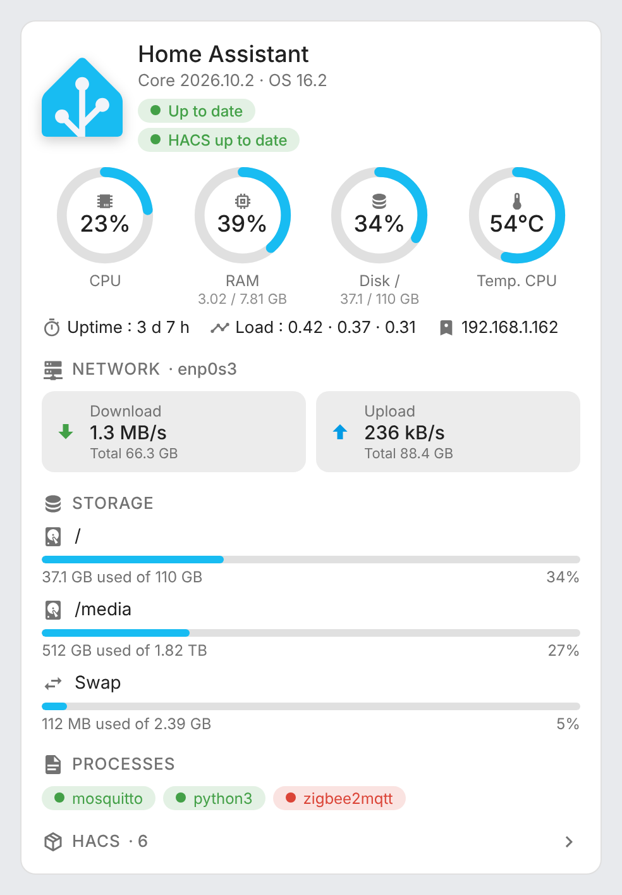 | 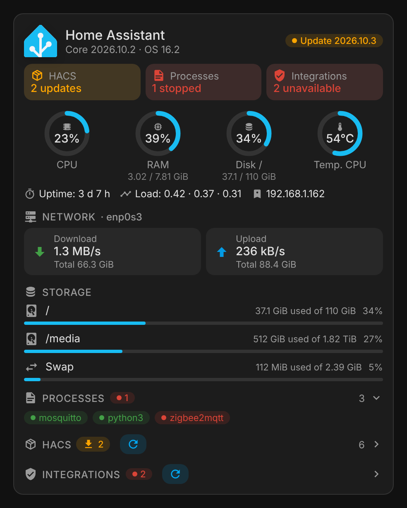 |
| 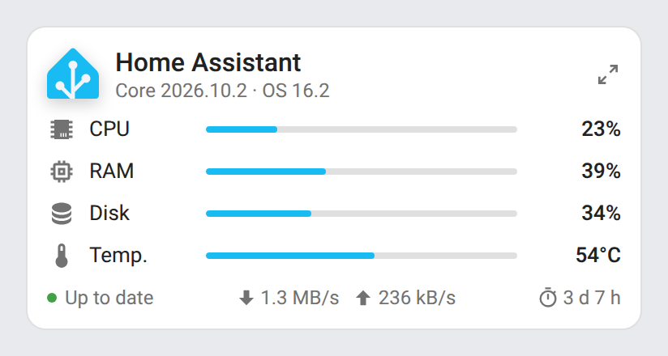 | 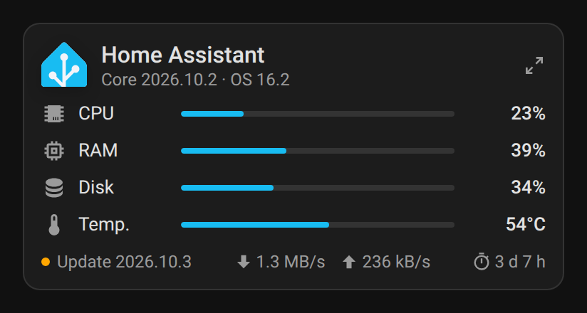 |
| 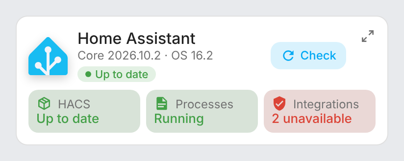 | 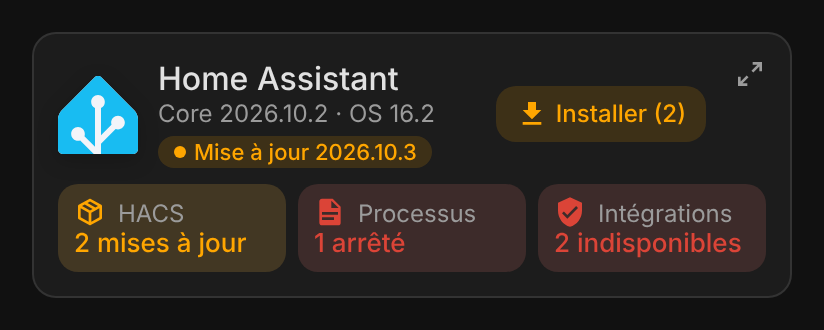 |
| 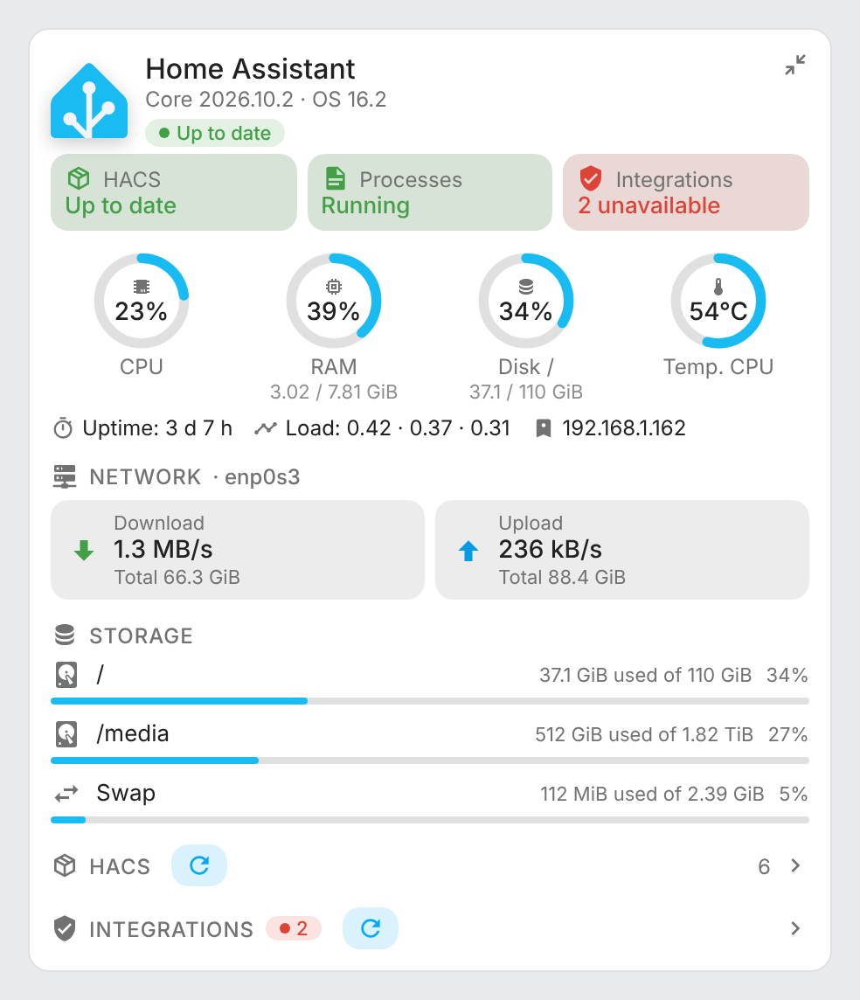 | 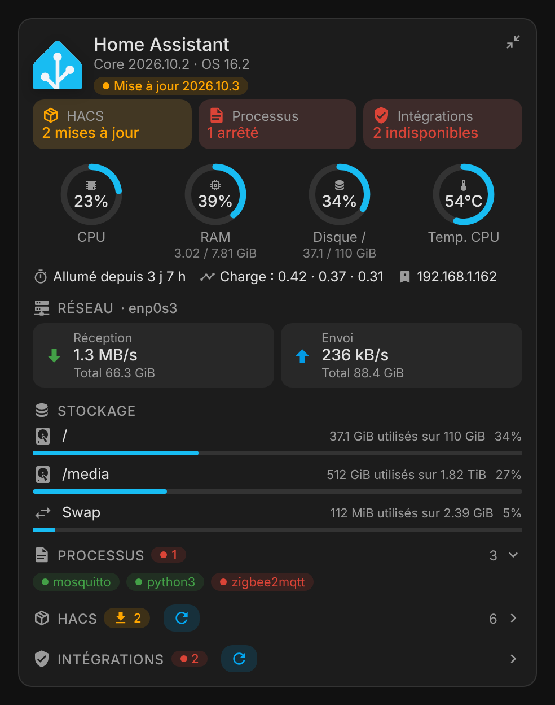 |
| 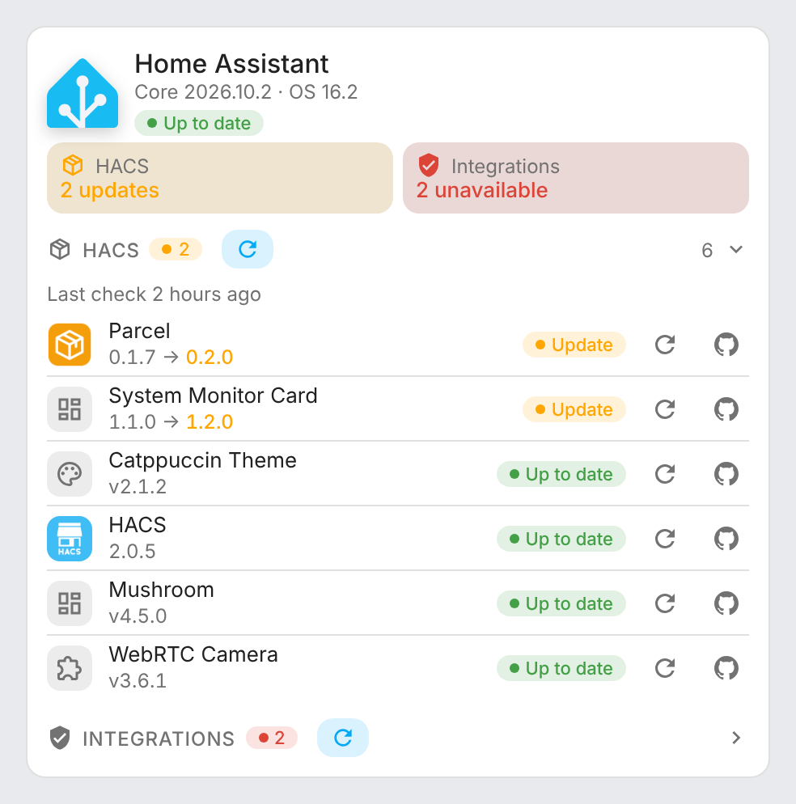 | 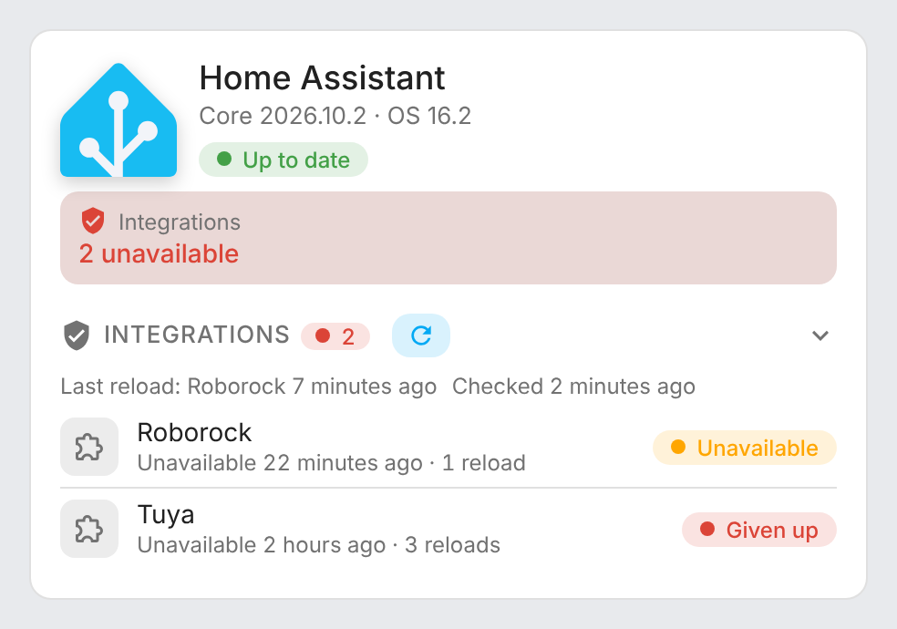 |
| 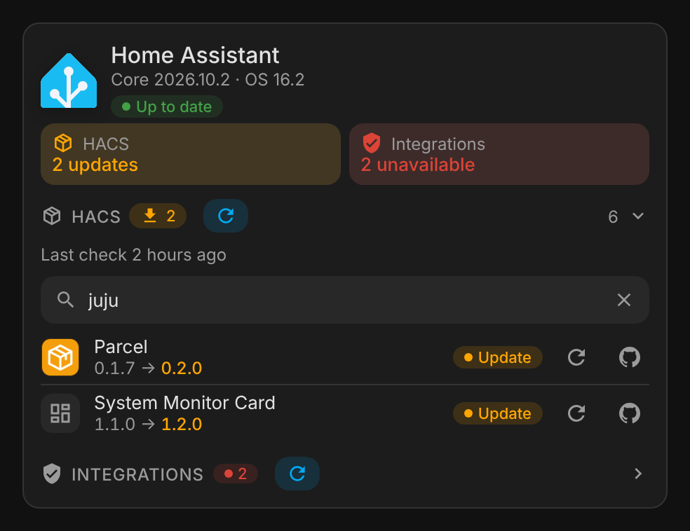 | 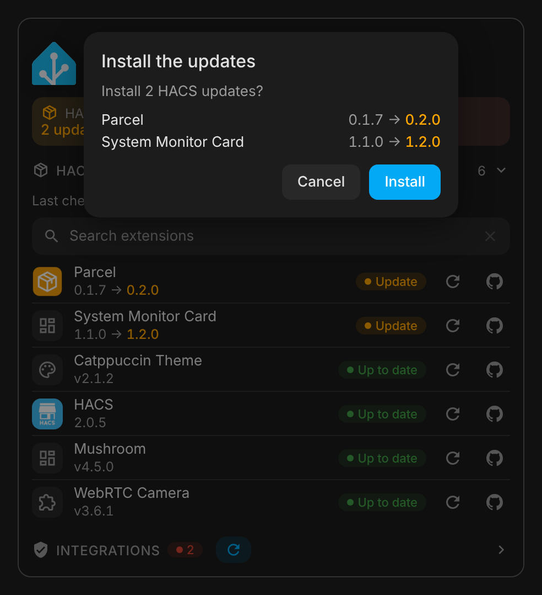 |

## How it works

The cards read the entity registry of Home Assistant and keep the entities of the `systemmonitor` platform. Each sensor is recognized by its translation key (`processor_use`, `memory_use_percent`, `disk_free`, `throughput_network_in`…), so entity ids translated in another language (for example `sensor.system_monitor_utilisation_du_processeur`) and renamed entities are supported. Mount points, interfaces and process names are read from the end of the sensor name. When the registry is not available, English entity ids (`sensor.system_monitor_processor_use`…) are used as a fallback.

The Core and OS versions come from the `update.home_assistant_core_*` and `update.home_assistant_operating_system_*` entities when they exist, otherwise from the running Home Assistant version.

### Status row

Under the header, a row of tiles gives the overall status of each section: **HACS** (up to date or the number of updates), **Processes** (running or the number stopped) and **Integrations** (available or the number unavailable), green when all is well, orange or red otherwise. Click a tile to show its section unfolded; a click elsewhere folds or hides it again. The Home Assistant Core / OS update stays next to the logo. Tiles of hidden or missing sections are left out.

### Status card

The minimal card keeps the header (Core / OS versions and their update badge) and the status row, without gauges or lists. The status row shows up only while one of the statuses is not good (HACS update, stopped process, unavailable integration); when all is well, the card is just the header. On the right of the header, one button:

- **Install (n)** when HACS updates are pending (admins only): installs them all, one after the other, after a confirmation, with the progress in the button
- **Check** otherwise, for every user as in the full card: checks every HACS repository for updates through [HACS Refresh](https://github.com/juju35/ha-hacs-refresh), with the progress in the button; hover it for the time of the last check. Without HACS Refresh and no pending update, the button is hidden

A click on the **HACS** tile opens HACS, on the **Integrations** tile the integrations page, and on the **Processes** tile the first stopped process.

At the far right of the header, a small round button (`mdi:arrow-expand`) shows the full card in its place: gauges, network, storage, processes, HACS and integrations lists, with the same options, exactly as the **System Monitor Card** shows them. The button turns into `mdi:arrow-collapse` and brings the status view back; a click anywhere outside the card does too, but not a click in a dialog opened from it (more-info), nor while the install confirmation is open. `zoom: false` removes the button.

### Processes

The processes section is hidden while every monitored process runs: the **Processes** tile of the status row says "Running", and a click on it shows the list, which hides again on a click on its title or elsewhere. As soon as a process is stopped, the section shows up by itself and stays, whatever you click, until every process runs again. Its title shows the number of processes, and the number stopped in red.

### HACS extensions

HACS creates an update entity for every repository it downloaded. The card lists them with their name and category (from the HACS device), installed and latest version, and the GitHub repository (from the release URL). The list is folded by default: click the **HACS** section, or its tile in the status row, to unfold it. Click a line to open its update dialog (release notes, install), its refresh button to check that extension alone for updates (needs HACS Refresh 0.2.0 or later), or the GitHub button to open the repository. The search field at the top of the unfolded list filters it as you type, by name or GitHub repository (case and accents ignored); the ✕ button or Escape clears it, and folding the list clears it too.

Logos are loaded dynamically, best source first:

1. For integrations, Home Assistant's brands proxy (`/api/brands`, Home Assistant 2026.3 and later), which serves the `brand/icon.png` shipped by a custom integration before the brands CDN
2. The brands CDN (`brands.home-assistant.io`)
3. The avatar of the GitHub owner of the repository
4. An icon for the HACS category (integration, dashboard, theme…)

**Check for updates** (the refresh button next to the HACS section title, visible even while the list is folded) presses the button of the [HACS Refresh](https://github.com/juju35/ha-hacs-refresh) integration: Home Assistant asks HACS to fetch every downloaded repository again from GitHub, in the background, and the card shows the progress and the time of the last check from HACS Refresh's sensors. The check goes on if you leave the page, and HACS Refresh can also check at an interval set in its options. Without HACS Refresh, the button is hidden and the unfolded list shows a link to install it.

**Install all updates**: when updates are pending, their number next to the HACS section title is a button (for admins). A click opens a confirmation popup at the top of the card, listing each extension with its current and new version (**Cancel**, a click outside the popup or Escape closes it), then **Install** installs every pending update one after the other through `update.install`, with the progress in the button. Integrations then need a Home Assistant restart (Home Assistant raises a repair for it), dashboard cards a browser reload.

### Unavailable integrations

When the [Integration Watchdog](https://github.com/juju35/ha-integration-watchdog) integration is set up, the card reads its sensors: its tile in the status row says whether every integration is available, and the **Integrations** section lists those whose entities are all unavailable, with the time they became unavailable, the number of reloads done by the watchdog, and **Given up** once it stopped reloading one. The section shows the last reload (in red when it failed) and the time of the last check. Click a line to open the integration page, the refresh button next to the title to check the integrations now (it presses the watchdog's **Check now** button), or the last reload to open its history. Like the HACS list, the section is folded by default and folds again on a click elsewhere. The section is hidden while every integration is available: a click on the **Integrations** tile of the status row shows it unfolded (last reload, last check, **Check now** button), and a click elsewhere hides it again.

Thresholds:

| Value | Orange | Red |
|---|---|---|
| CPU usage | 70 % | 90 % |
| RAM usage | 80 % | 95 % |
| Disk usage | 80 % | 90 % |
| CPU temperature | 75 °C | 90 °C |
| Swap usage | 50 % | 80 % |

## Development

```bash
npm ci               # installs the locked dev dependencies (Playwright, for the screenshots)
npm run build        # bundles src/system-monitor-card.js + images/home-assistant.svg into dist/system-monitor-card.js
npm run check        # builds and checks the card (run in CI)
npm run screenshots  # renders the cards with mock data (scripts/mock-states.mjs) into screenshots/
```

`dist/` is not committed: `npm run build` creates it locally, CI builds it on every push, and the release workflow attaches the built file to the release, which is where HACS downloads it from.

### Releasing

1. Bump `version` in `package.json`
2. Add a `## <version>` section at the top of [CHANGELOG.md](CHANGELOG.md)
3. Push to `main`: the **Release** workflow builds the card, creates the tag and the GitHub release with the changelog section as notes, and attaches `system-monitor-card.js`

## Translations

The cards auto-detect the language from your Home Assistant settings. Currently supported:

| Language | Code |
|---|---|
| English | `en` |
| Français | `fr` |

Contributions for additional languages are welcome!

## License

[MIT](LICENSE)

The Home Assistant logo is a trademark of the Open Home Foundation and is used here to identify Home Assistant.
