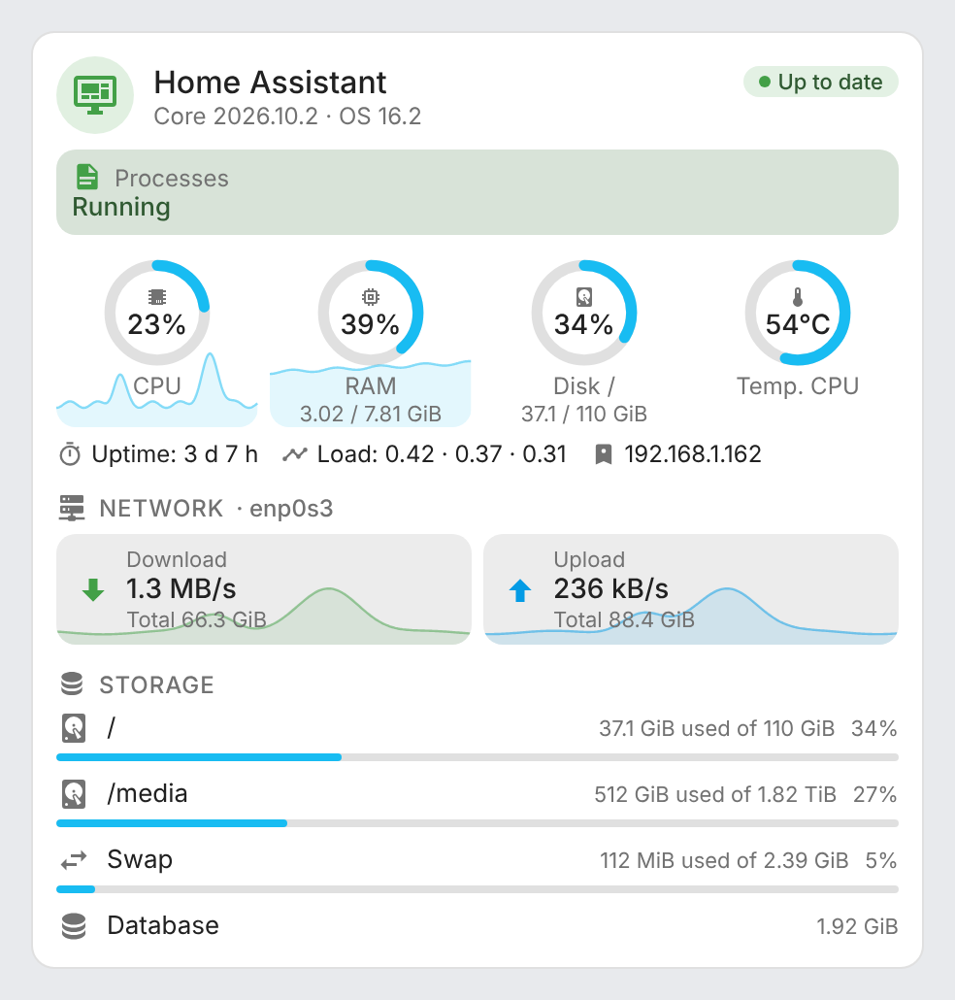
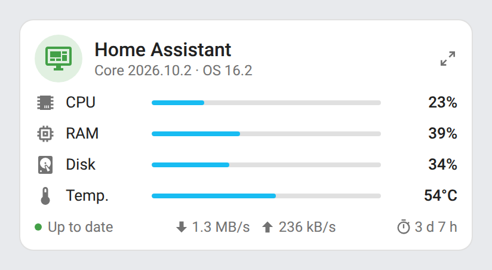
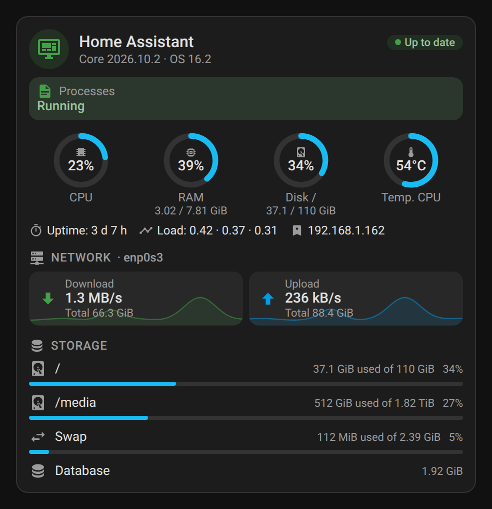
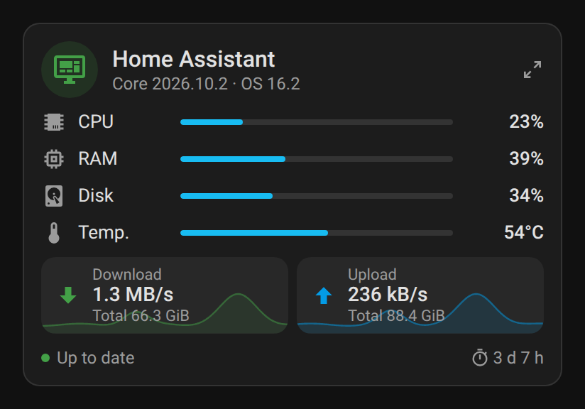
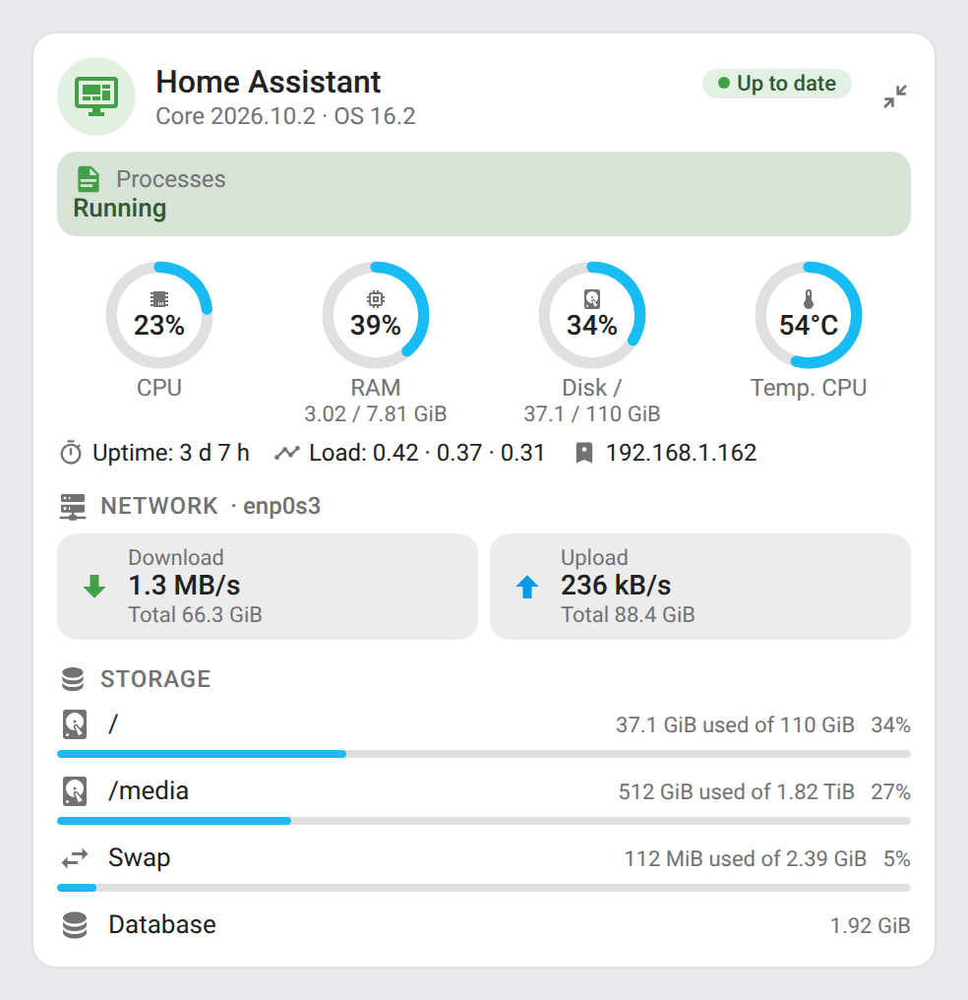
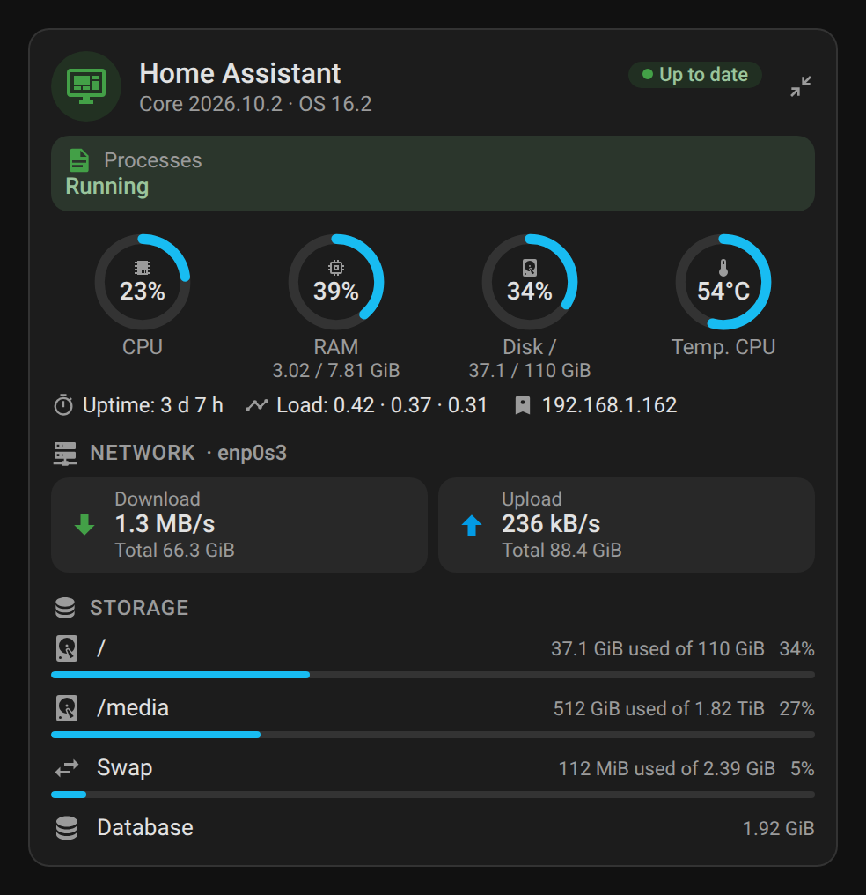

# ha-system-monitor-card

[](https://www.home-assistant.io/integrations/marketplace/)
[](https://github.com/juju35/ha-system-monitor-card/actions/workflows/hacs.yml)
[](https://github.com/juju35/ha-system-monitor-card/actions/workflows/validate.yml)
[](https://github.com/juju35/ha-system-monitor-card/actions/workflows/lint.yml)
[](https://github.com/juju35/ha-system-monitor-card/releases/latest)
[](https://github.com/juju35/ha-system-monitor-card/blob/main/LICENSE)
[](https://buymeacoffee.com/julienstep9)

<p align="center"></p>

Lovelace cards for Home Assistant to monitor the machine running Home Assistant itself: CPU, RAM, disk, temperature, network, storage and processes at a glance.

The cards are built on top of the core [System Monitor integration](https://www.home-assistant.io/integrations/systemmonitor/): entities are **discovered automatically**, you don't have to pick them one by one, and it works whatever the language of your installation.

[](https://my.home-assistant.io/redirect/marketplace_repository/?owner=juju35&repository=ha-system-monitor-card&category=plugin)

| System Monitor Card | System Monitor Mini Card |
|---|---|
|  |  |

## Features

- Two cards: a full **System Monitor Card** and a compact **System Monitor Mini Card**
- **Zoom** on the mini card: a button at the top right switches it to the full System Monitor card (same options) and back; a click anywhere outside the card brings it back too
- Automatic discovery of the System Monitor entities through the entity registry (any language)
- CPU, RAM, disk and CPU temperature gauges, uptime, load average and IP address
- Home Assistant Core and OS versions, with an orange badge when an update is available
- Network download / upload rates and totals, per interface (virtual interfaces such as `docker0` or `hassio` are hidden)
- **24 h history**: a discreet curve of the last 24 hours behind the CPU and RAM gauges (bars on the mini card) and each download / upload rate, on the full card and the mini card, from the recorder's statistics on a real time axis, with a break where the recorder has no data (refreshed every 5 minutes; `show_history: false` turns it off)
- Storage: every monitored mount point and the swap, with used space, and the size of the Home Assistant database
- Backups: when the last automatic backup was made and when the next one is due, orange / red when it gets old or the last attempt failed (the mini card shows it only then), from Home Assistant's own backup sensors
- Monitored processes, green when running and red when stopped: hidden while they all run (their status tile shows the list on a click), always shown while one is stopped, with their overall status in the status row
- Colors turn orange / red when a threshold is crossed (CPU, RAM, disk, temperature, swap), with thresholds you can change
- Click any value to open its Home Assistant history (more-info dialog)
- Visual editor in the dashboard UI for every card (no YAML needed)
- Light and dark mode, English, French, German, Spanish, Serbian (Cyrillic and Latin), Italian, Dutch, European Portuguese, Polish, Romanian, Danish, Swedish, Bulgarian, Russian, Ukrainian, Hungarian, Slovak, Czech, Slovenian, Latvian and Greek
- Single file, no external dependency

## Supported integrations

| Integration | What the cards show |
|---|---|
| [System Monitor](https://www.home-assistant.io/integrations/systemmonitor/) (built in) | CPU, RAM, disk and temperature gauges, uptime, load, IP address, network, storage and swap, monitored processes |
| [File Size](https://www.home-assistant.io/integrations/filesize/) (built in, optional) | Size of the Home Assistant database |
| Home Assistant updates (built in, `update.home_assistant_*`) | Core and OS versions, with a badge when an update is available |

The Marketplace updates and the unavailable integrations have their own cards: [Marketplace Refresh](https://github.com/juju35/ha-marketplace-refresh) and [Integration Watchdog](https://github.com/juju35/ha-integration-watchdog).

## Prerequisites

Home Assistant 2024.8 or later, and:

The [System Monitor integration](https://www.home-assistant.io/integrations/systemmonitor/) must be added (**Settings → Devices & services → Add integration → System Monitor**).

Most of its sensors are disabled by default: open the **System Monitor** device and enable the ones you want to see on the card, for example:

| Card section | Sensors to enable |
|---|---|
| System | Processor use, Memory usage (or Memory use + Memory free), Disk usage / Disk use + Disk free, Processor temperature, Last boot (called Uptime in recent versions), Load (1m/5m/15m), IPv4 address |
| Network | Network throughput in / out, Network in / out (totals) |
| Storage | Disk use + Disk free for each mount point, Swap use + Swap free. For the database size, the [File Size](https://www.home-assistant.io/integrations/filesize/) integration on `/config/home-assistant_v2.db` (see below) |
| Processes | Process binary sensors (configured in the integration options) |

Sections and gauges without any enabled sensor are simply not displayed.

## Installation

### Via the Marketplace (recommended)

Click the button below to add the repository directly:

[](https://my.home-assistant.io/redirect/marketplace_repository/?owner=juju35&repository=ha-system-monitor-card&category=plugin)

Then click **Install**, and reload your browser when the Marketplace asks you to.

Or manually:

1. Open **Settings → Marketplace → Add from link** (top right; this needs a GitHub account connected)
2. Add `https://github.com/juju35/ha-system-monitor-card` — Type: **Dashboard**
3. Open **System Monitor Card** and click **Install**
4. Clear your browser cache and refresh

### Manual

1. Download `system-monitor-card.js` and the `system-monitor-card.i18n.*.js` translation files from the [latest release](https://github.com/juju35/ha-system-monitor-card/releases/latest)
2. Copy them all to `/config/www/` (without the translation files, the cards show in English)
3. Go to **Settings → Dashboards → ⋮ → Resources** → Add resource:
   - URL: `/local/system-monitor-card.js`
   - Type: **JavaScript Module**
4. Clear your browser cache and refresh

## Configuration

### Visual editor

Edit a dashboard, click **Add card** and search for **System Monitor Card** or **System Monitor Mini Card**. Set an optional title, choose the sections to display, the network interface and the language. The preview updates live, and options left at their default are kept out of the generated YAML.

### Minimal

```yaml
type: custom:system-monitor-card
```

```yaml
type: custom:system-monitor-mini-card
```

### Full options

```yaml
type: custom:system-monitor-card
title: My Home Assistant
show_system: true
show_network: true
show_history: true
show_storage: true
show_backups: true
show_processes: true
interface: eth0
language: fr
cpu_warning: 70
cpu_critical: 90
ram_warning: 80
ram_critical: 95
disk_warning: 80
disk_critical: 90
temp_warning: 75
temp_critical: 90
swap_warning: 50
swap_critical: 80
backup_warning: 2
backup_critical: 7
```

```yaml
type: custom:system-monitor-mini-card
title: My Home Assistant
show_storage: true
show_network: true
show_history: true
zoom: true
interface: eth0
language: fr
cpu_warning: 70
cpu_critical: 90
```

### Options reference

| Option | Card | Default | Description |
|---|---|---|---|
| `title` | all | `Home Assistant` | Card title |
| `show_system` | full | `true` | CPU, RAM, disk and temperature gauges, uptime, load, IP address |
| `show_network` | full, mini | `true` | Network download / upload |
| `show_history` | full, mini | `true` | 24 h curve behind the CPU and RAM gauges (bars on the mini card, RAM from its `memory_use_percent` sensor, on a 0–100 % scale) and each download / upload rate, from the recorder's 5-minute statistics (one query for all of them) (on the mini card, the rates then show as tiles above the footer instead of in it) |
| `show_storage` | full, mini | `true` | Full card: mount points, swap and database size. Mini card: disk bar |
| `show_backups` | full, mini | `true` | Full card: the last and next automatic backups at the end of Storage. Mini card: an orange / red item when the last backup is too old or failed |
| `show_processes` | full | `true` | Monitored processes and their status tile |
| `zoom` | mini | `true` | Zoom button at the top right: shows the full card, and back to the compact view |
| `interface` | full, mini | All physical interfaces | Network interface to display (e.g. `eth0`, `enp0s3`) |
| `cpu_warning` / `cpu_critical` | full, mini | `70` / `90` | CPU usage (%) from which the gauge turns orange / red |
| `ram_warning` / `ram_critical` | full, mini | `80` / `95` | RAM usage (%) from which the gauge turns orange / red |
| `disk_warning` / `disk_critical` | full, mini | `80` / `90` | Disk usage (%) from which the gauges and storage bars turn orange / red |
| `temp_warning` / `temp_critical` | full, mini | `75` / `90` | CPU temperature (°C, whatever the unit of the sensor) from which the gauge turns orange / red |
| `swap_warning` / `swap_critical` | full | `50` / `80` | Swap usage (%) from which the swap bar turns orange / red |
| `backup_warning` / `backup_critical` | full, mini | `2` / `7` | Days since the last successful automatic backup from which the backup turns orange / red (red also when the last attempt failed, or there was never one) |
| `language` | all | Auto | Force language: `en`, `fr`, `de`, `es`, `sr`, `sr-Latn`, `it`, `nl`, `pt`, `pl`, `ro`, `da`, `sv`, `bg`, `ru`, `uk`, `hu`, `sk`, `cs`, `sl`, `lv` or `el` (auto-detects from HA settings) |

## Screenshots

| Light | Dark |
|---|---|
|  |  |
|  |  |
|  |  |

## How it works

The cards read the entity registry of Home Assistant and keep the entities of the `systemmonitor` platform. Each sensor is recognized by its translation key (`processor_use`, `memory_use_percent`, `disk_free`, `throughput_network_in`…), so entity ids translated in another language (for example `sensor.system_monitor_utilisation_du_processeur`) and renamed entities are supported. Mount points, interfaces and process names are read from the end of the sensor name, after the device name and the label: a mount point starts at its first `/` (so names with spaces, `/mnt/My Passport`, are kept whole), an interface is the last word, a process name is what follows `Process` (or the label the other processes share). This works for a sensor alone of its kind too (`Disk usage /config`). A sensor renamed in its entity settings (`WAN up`, `Root free`) no longer says its argument: it is read from its entity id instead, which Home Assistant made from the original name (`sensor.system_monitor_network_throughput_out_eth0` → `eth0`, `sensor.system_monitor_disk_free` → `/`). When the registry is not available, English entity ids (`sensor.system_monitor_processor_use`…) are used as a fallback.

The Core and OS versions come from the `update.home_assistant_core_*` and `update.home_assistant_operating_system_*` entities when they exist, otherwise from the running Home Assistant version.

### Status row

Under the header, a tile gives the overall status of the **Processes** section (running or the number stopped), green when all is well, red otherwise. The Core / OS update badge turns grey "Unknown" when the update entity is unavailable. Click the tile to show the section unfolded; a click elsewhere folds or hides it again. The Home Assistant Core / OS update stays next to the logo. The tile is left out when the section is hidden or has no process.

### Mini card

The compact card shows CPU, RAM, disk and temperature bars, then the Core / OS status, the network rates and the uptime. While a monitored process is stopped, its header icon turns red and its footer shows a red "N stopped" item: a click on it shows the full card with the processes list unfolded (with `zoom: false`, it opens the first stopped process). At the far right of the header, a small round button (`mdi:arrow-expand`) shows the full card in its place, with the same options, exactly as the **System Monitor Card** shows it, and turns into `mdi:arrow-collapse` to bring the compact view back; a click anywhere outside the card does too, but not a click in a dialog opened from it (more-info). `zoom: false` removes the button.

### Processes

The processes section is hidden while every monitored process runs: the **Processes** tile of the status row says "Running", and a click on it shows the list, which hides again on a click on its title or elsewhere. As soon as a process is stopped, the section shows up by itself and stays, whatever you click, until every process runs again. Its title shows the number of processes, and the number stopped in red.

### Backups

The **Storage** section also shows Home Assistant's automatic backups, from the sensors of the built-in Backup integration (Home Assistant 2025.2 or later, nothing to set up): *Last successful automatic backup*, *Last attempted automatic backup*, *Next scheduled automatic backup* and *Backup manager state*. The row shows when the last one was made and when the next one is due; it turns orange after `backup_warning` days, red after `backup_critical` days, when the last attempt failed or when there was never one, and says *Backing up…* while one runs. Click it for the sensor's history. Only automatic backups count (set them up in **Settings → System → Backups**).

### Database size

The **Storage** section ends with the size of the Home Assistant database (the default SQLite one, `home-assistant_v2.db`), read from the [File Size](https://www.home-assistant.io/integrations/filesize/) integration. To get it:

1. Allow Home Assistant to read the file, in `configuration.yaml`, then restart:
   ```yaml
   homeassistant:
     allowlist_external_dirs:
       - /config
   ```
2. **Settings → Devices & services → Add integration → File Size**, with the path `/config/home-assistant_v2.db`.

The card finds its size sensor by itself (platform `filesize`, a file named `home-assistant_v2.db`); a click on the row opens its history. Without it, the row is not shown. An external database (MariaDB, PostgreSQL) is not a file and isn't supported.

### Thresholds

Gauges and bars turn orange, then red, when a value reaches these thresholds (the defaults; each can be changed with the `*_warning` / `*_critical` options, in YAML or in the visual editor):

| Value | Orange | Red |
|---|---|---|
| CPU usage | 70 % | 90 % |
| RAM usage | 80 % | 95 % |
| Disk usage | 80 % | 90 % |
| CPU temperature | 75 °C (167 °F) | 90 °C (194 °F) |
| Swap usage | 50 % | 80 % |

The CPU temperature is shown in the unit of its sensor, which follows the unit system of Home Assistant (°C, or °F with US customary units) or the display unit chosen in the sensor's settings; the thresholds are in °C and apply to the same temperature in any unit.

## Development

```bash
npm ci               # installs the locked dev dependencies (Playwright, for the screenshots)
npm run build        # bundles src/system-monitor-card.js + images/home-assistant.svg into dist/system-monitor-card.js
npm run check        # builds and checks the card (run in CI)
npm run screenshots  # renders the cards with mock data into screenshots/ (ffmpeg compares the pixels of the captures)
```

`dist/` is not committed: `npm run build` creates it locally, CI builds it on every push, and the release workflow attaches the built file to the release, which is where the Marketplace installs it from.

### Releasing

1. Bump `version` in `package.json`
2. Add a `## <version>` section at the top of [CHANGELOG.md](https://github.com/juju35/ha-system-monitor-card/blob/main/CHANGELOG.md)
3. Push to `main`: the **Release** workflow builds the card, creates the tag and the GitHub release with the changelog section as notes, and attaches `system-monitor-card.js`

## Translations

The cards auto-detect the language from your Home Assistant settings. Currently supported:

| Language | Code |
|---|---|
| English | `en` |
| Français | `fr` |
| Deutsch | `de` |
| Español | `es` |
| Српски | `sr` |
| Srpski (latinica) | `sr-Latn` |
| Italiano | `it` |
| Nederlands | `nl` |
| Português (Portugal) | `pt` |
| Polski | `pl` |
| Română | `ro` |
| Dansk | `da` |
| Svenska | `sv` |
| Български | `bg` |
| Русский | `ru` |
| Українська | `uk` |
| Magyar | `hu` |
| Slovenčina | `sk` |
| Čeština | `cs` |
| Slovenščina | `sl` |
| Latviešu | `lv` |
| Ελληνικά | `el` |

Regional variants fall back to the base language (`it-IT` → `it`, `nl-BE` → `nl`, `pl-PL` → `pl`); Brazilian Portuguese (`pt-BR`) uses the European Portuguese translation. In the languages whose plurals have more than two forms (Serbian, Polish, Romanian, Russian, Ukrainian, Slovak, Czech, Slovenian and Latvian), counts other than 1 read "label: {n}" (`Nedostupne: 2`).

Contributions for additional languages are welcome!

## License

[MIT](https://github.com/juju35/ha-system-monitor-card/blob/main/LICENSE)

## Support

If you find this project useful, you can support its development:

<a href="https://buymeacoffee.com/julienstep9"></a>
